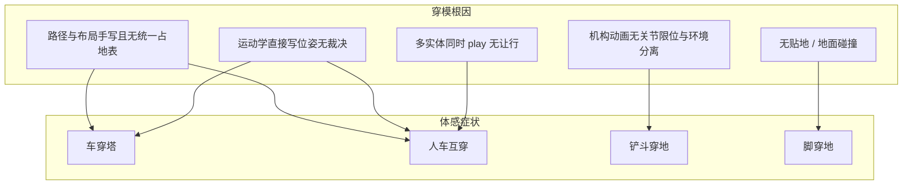

# 场景穿模与物理碰撞方案说明

> 本文档梳理当前三维施工场景中的**穿模问题成因**，以及可选的**碰撞 / 物理解决方案**。  
> 与主文档 [`工业基建施工场景-项目生成说明.md`](./工业基建施工场景-项目生成说明.md)、动画文档 [`场景动画与动作实现说明.md`](./场景动画与动作实现说明.md) 配套：主文档管视觉基线，动画文档管动作系统，本文档管空间约束与物理层。  
> 技术栈：Vue 3 + TypeScript + Three.js + Vite  
> 产品取向：**更偏向真实物理**（刚体碰撞、重力/贴地、机构与环境互不穿透），同时兼顾示意级视觉风格与办公机性能。

---

## 1. 结论摘要

| 问题 | 结论 |
| ---- | ---- |
| 穿模是不是渲染 bug？ | **不是**。运动层只有「折线路径 + 关节时间驱动」，世界几何只是背景。 |
| 根因是什么？ | **缺少空间约束层**：无障碍查询、无碰撞体、无贴地、无机构工作空间限制。 |
| 动画文档当初怎么说？ | 阶段 1 验收写「路径手写避让即可」；阶段 3 明确「不做物理引擎耦合」——那是早期示意级取舍，**不代表最终不能上物理**。 |
| 推荐方向（当前偏好） | **接入轻量真实物理（推荐 Rapier）+ 布局/路径数据对齐**；软检测与手写避让作为过渡或降级兜底。 |

推荐推进顺序（真实物理取向）：

1. **问题止血**：立刻修正明显穿塔 / 人车交叉的硬编码路径（低成本、立刻可见）  
2. **物理基建**：接入 Rapier（或同等 WASM 物理）、统一碰撞体注册、主循环同步位姿  
3. **移动体刚体化**：车辆 / 工人改为物理驱动或「运动学体 + 碰撞」  
4. **机构约束**：挖机臂 / 吊臂限位 + 与静态障碍分离  
5. **贴地与地面**：地面碰撞体或高度采样，消除脚/支腿穿地  

---

## 2. 问题描述：什么叫「各种穿模」

在本项目语境下，「穿模」指三维实体在视觉上进入了彼此或进入了本应实体的空间，主要包括：

| 类型 | 典型表现 | 严重度（当前场景） |
| ---- | -------- | ------------------ |
| 路径穿设施 | 卡车驶过铁塔基础 / 塔腿 | 高 |
| 动态体互穿 | 挖机与工人同区交叉；卡车与搅拌车路径重叠 | 高 |
| 机构扫入世界 | 挖机铲斗/臂杆扫进地面或行人区；吊臂扫过空域无约束 | 中–高 |
| 脚 / 支腿穿地 | 工人抬腿时脚底低于地面；吊车支腿落到 `y=0` 无校正 | 中（近看明显） |
| 模型自穿模 | 单体内零件交错（进料斗、液压杆等） | 低–中（部分已手工修） |
| 路径回路瞬移 | 循环路径首尾不闭合时瞬间跳回起点 | 低–中 |

用户体感上的「没有物理规则」是准确的：**当前没有任何「不能穿过」的规则在运行时生效**。

---

## 3. 现状盘点（与空间约束相关）

### 3.1 能力矩阵


| 能力 | 是否存在 | 说明 |
| ---- | -------- | ---- |
| 路径跟随（车辆 / 工人） | 有 | `VehicleMotionController` / `WorkerLocomotionController`，XZ 折线 |
| 障碍检测 / 避障 | **无** | 路径点硬编码，不查询场景 |
| 物理引擎 | **无** | `package.json` 仅 `three` / `vue` / `pinia` |
| AABB / 圆碰撞对消 | **无** | `Box3` 仅用于选中光圈与相机聚焦 |
| Raycast | 仅交互选中 | `InteractionManager` 点选，不做地面 / 障碍 |
| NavMesh / A* | **无** | — |
| 贴地跟随 | **无** | 注释写「贴地」，实际固定 `y=0` |
| 机构工作空间限制 | **无** | 挖机 / 吊车纯时间驱动正弦或匀速 |

### 3.2 运动模型本质

当前是 **运动学演示器**：

```text
硬编码路径点 / 正弦关节角
        ↓
每帧直接写 Object3D.position / rotation
        ↓
渲染
```

没有「世界是否允许这个位姿」的裁决步骤。

### 3.3 关键代码位置


| 路径 | 职责 | 与穿模的关系 |
| ---- | ---- | ------------ |
| [`src/scene/animation/bootstrapSceneAnimations.ts`](../src/scene/animation/bootstrapSceneAnimations.ts) | 按 `objectId` 注册控制器 + **硬编码路径点** | 路径穿塔 / 人车交叉的直接来源 |
| [`src/scene/animation/controllers/VehicleMotionController.ts`](../src/scene/animation/controllers/VehicleMotionController.ts) | XZ 折线、加减速、朝向、轮/履带滚动 | 只改 `x/z`，不读障碍 |
| [`src/scene/animation/controllers/WorkerLocomotionController.ts`](../src/scene/animation/controllers/WorkerLocomotionController.ts) | 路径跟随 + 正弦步态 | `y=0`，无脚底接地 |
| [`src/scene/animation/controllers/ExcavatorActionController.ts`](../src/scene/animation/controllers/ExcavatorActionController.ts) | 回转 / 臂 / 斗正弦 | 无工作空间与障碍约束 |
| [`src/scene/animation/controllers/CraneActionController.ts`](../src/scene/animation/controllers/CraneActionController.ts) | 支腿 / 转台 / 变幅 / 伸缩 / 钩 | 臂尖可扫入空域，无碰撞 |
| [`src/scene/animation/AnimationRegistry.ts`](../src/scene/animation/AnimationRegistry.ts) | 统一 `update(delta)` | 可挂物理步进同步点 |
| [`src/constants/scale.ts`](../src/constants/scale.ts) | 车长宽、塔基半宽、站区 pad 等 | 可推导碰撞体外形 |
| [`src/scene/InteractionManager.ts`](../src/scene/InteractionManager.ts) | `Raycaster` + `Box3` | 可复用包围盒思路，但用途不同 |
| 各 `*Builder` | 初始摆位 | 与动画路径解耦，启动后常被路径首点覆盖 |

### 3.4 已观察到的高风险坐标（单位：米，XZ）


| 对象 | 路径 / 位置摘要 | 风险 |
| ---- | --------------- | ---- |
| 铁塔 | `FACILITY_LAYOUT` 约 `(22, 4)`，`baseHalf = 3.2` | 静态障碍核心 |
| `truck_02` | `… → (22, 8) → …` | 距塔约 4 m，车宽约 2.4 m，**极易穿塔腿 / 基础** |
| `mixer_01` | `… → (24, 6) → …` | 与卡车同在东南作业区，靠近铁塔 |
| `excavator_01` | `(-4,8) → (2,10) → (6,6) → …` | 与工人路径重叠 |
| `worker_03` | `(2,10) → (8,12) → …` | 与挖机路径交叉，并向铁塔方向延伸 |
| 导线走廊 | 门架→铁塔弧垂，`mid.y ≥ 9.5` | 地面车辆一般不穿导线；卷盘摆位已有手工避让注释 |

### 3.5 已有可复用钩子（尚非碰撞系统）

1. **`tagSelectable` / `userData`**：可扩展 `footprintRadius`、`collider: true`、`physicsBodyId`。  
2. **`tagAnimatable` / `joints`**：机构限位、铰链约束可挂在关节元数据上。  
3. **`AnimationRegistry`**：统一 tick；物理世界步进可与动画同循环或紧邻执行。  
4. **尺度常量**（`VEHICLE_SCALE` / `PYLON_SCALE` / `SUBSTATION_SCALE`）：碰撞体外形的权威来源，避免凭感觉估半径。  
5. **选中用 `Box3.setFromObject`**：证明运行时包围盒可用；物理层更宜用**简化代理碰撞体**（盒 / 胶囊 / 圆柱），不要直接拿渲染网格当 collider。

---

## 4. 根因分类（便于对症下药）



| 根因编号 | 说明 | 主要对症方案 |
| -------- | ---- | ------------ |
| R1 | 路径 / 摆位分散，无占地校验 | 统一 `sceneLayout`；物理静态体烘焙 |
| R2 | 控制器不查询世界 | 物理碰撞或至少 XZ 软检测 |
| R3 | 关节纯时间驱动 | 铰链限位 + 可选机构碰撞体 |
| R4 | `y` 写死为 0 | 地面 collider / 高度采样 |
| R5 | 演示全开同时运动 | 物理互撞 + 可选时间编排 |

---

## 5. 解决方案总览

按「真实度 ↑、工程成本 ↑」排列。本项目当前偏好落在 **方案 P（真实物理）**，轻量方案作为过渡与降级。

### 5.1 方案对照表


| 方案 | 名称 | 真实度 | 工程量 | 性能风险 | 与偏好契合 |
| ---- | ---- | ------ | ------ | -------- | ---------- |
| L0 | 手写避让路径 + 统一布局表 | 低 | 低 | 极低 | 过渡必做 |
| L1 | XZ 占地圆 / AABB 软检测 | 中低 | 中 | 低 | 降级兜底 |
| L2 | 机构幅度夹紧 + 作业时停车 | 中 | 低–中 | 极低 | 物理前可先做 |
| L3 | 演示时间编排（错峰 play） | 低 | 低 | 极低 | 辅助 |
| **P** | **真实物理引擎（推荐 Rapier）** | **高** | **高** | **中** | **主目标** |
| P+ | 物理 + 简易寻路 / 导航网格 | 很高 | 很高 | 中–高 | 二期 |

---

## 6. 轻量方案（过渡 / 兜底）

> 即使最终上真实物理，也建议先做 L0：立刻消掉最刺眼的穿塔与人车交叉，并为物理静态体提供干净的初始布局数据。

### 6.1 L0 — 统一布局 + 手写避让路径

**做法：**

- 新增 `src/scene/layout/sceneLayout.ts`（或等价模块），集中：
  - 设施世界坐标与朝向  
  - 车辆 / 工人初始位  
  - 演示路径点列  
  - 占地半径或盒尺寸（供后续物理与软检测共用）  
- 重画高风险路径：`truck_02`、`mixer_01` 远离铁塔 footprint；挖机与 `worker_02/03` 分区或错相位。  
- Builder 初始位与路径首点一致，避免动画启动瞬移。

**优点：** 成本低、立刻见效。  
**缺点：** 靠人工维护；加新实体易再穿。  
**定位：** 物理上线前的止血，以及物理失败时的内容底线。

### 6.2 L1 — XZ 软碰撞

**做法：**

- 静态障碍注册圆或轴对齐矩形。  
- 移动体每帧采样下一位置；相交则减速 / 停在上一点。  
- 不做弹力、摩擦力、角冲量。

**优点：** 实现快，防回归。  
**缺点：** 不像真实物理；斜向滑开、堆叠、倾覆等表现做不出来。  
**定位：** 物理未就绪时的运行时护栏，或低端设备降级路径。

### 6.3 L2 — 机构与步态夹紧

**做法：**

- 挖机：缩小 `slew/boom/stick` 幅度；或「作业时停车、行走时收臂」。  
- 吊车：限制转台角域、缩短伸缩脉冲。  
- 工人：减小抬腿；简单脚底 `y` 下限。

**定位：** 专治臂 / 脚穿模；与物理层正交，可长期保留为动画层安全阀。

### 6.4 L3 — 时间编排

**做法：** 不同实体错峰 `play`，或剧本分段。  
**定位：** 演示观感辅助，不能替代碰撞。

---

## 7. 主推方案 P — 真实物理层

### 7.1 为什么选「真物理」而不是永远手写避让

| 诉求 | 手写路径 | 软检测 | 真物理 |
| ---- | -------- | ------ | ------ |
| 车不能穿塔 | 靠人眼 | 能拦 | 能拦 + 可滑开 / 停下 |
| 人车互撞 | 靠错开路径 | 部分 | 自然互斥 |
| 铲斗碰地 | 难 | 难 | 碰撞体可挡 |
| 支腿 / 脚贴地 | 难 | 弱 | 地面刚体或射线 |
| 后续加车加路 | 维护成本指数升 | 中 | 碰撞体注册即可扩展 |
| 工程与包体成本 | 低 | 中 | 高（一次性基建） |

在「更偏真实物理」的前提下，**L0/L2 做内容与动画护栏，P 做运行时真相来源**。

### 7.2 引擎选型建议


| 引擎 | 语言 / 形态 | 与 Three 集成 | 建议 |
| ---- | ----------- | ------------- | ---- |
| **Rapier**（`@dimforge/rapier3d-compat`） | Rust → WASM | 社区成熟，与 Three 同步位姿清晰 | **首选** |
| cannon-es | 纯 JS | 接入简单 | 备选；性能与维护弱于 Rapier |
| Ammo.js | Bullet 移植 | 体积大、类型体验差 | 不推荐 |
| 自研冲量求解 | — | — | 不推荐 |

**选定默认：Rapier 3D（compat 包，便于 Vite 打包）。**

### 7.3 目标架构

```text
src/scene/
  physics/                         # 新建
    PhysicsWorld.ts                # Rapier World、步进、时间累加
    colliders/
      StaticColliderFactory.ts     # 地面、塔、变电站 pad、静态设施
      DynamicColliderFactory.ts    # 车辆盒/胶囊、工人胶囊
      JointColliderFactory.ts      # （可选）臂节盒体
    sync/
      PhysicsToThreeSync.ts        # 刚体 → Object3D
      KinematicDrive.ts            # 路径目标 → 运动学刚体速度/位移
    types.ts                       # PhysicsBodyHandle、ColliderTag 等
  animation/                       # 保留：机构动画、步态、演示编排
  layout/
    sceneLayout.ts                 # 摆位 + 路径 + 占地（内容 SSOT）
  SceneManager.ts                  # 循环：physics.step → sync → animation（机构）→ render
```

原则：

- **物理世界是移动体位姿的权威来源**（至少对 root 平移 / 朝向）。  
- **Builder 只建渲染网格 + 声明碰撞代理描述**（不要用 dense mesh collider）。  
- **Animation 层**：  
  - 整车位移：改为驱动运动学刚体或施加期望速度，而不是直接写 `root.position`。  
  - 机构关节：可先保留动画驱动 + 关节限位；二期再上铰链约束。  
- **业务层**仍只发「去某点 / 播放某动作」，不直接碰 Rapier API。

### 7.4 碰撞体策略（示意级视觉 × 真实物理）


| 实体 | 推荐代理体 | 刚体类型 | 备注 |
| ---- | ---------- | -------- | ---- |
| 地面 | 大厚度盒或高度场简化盒 | Fixed | 先用平面盒即可 |
| 铁塔基础 / 塔腿 | 盒或复合盒 | Fixed | 用 `PYLON_SCALE.baseHalf` |
| 变电站 pad / 主楼 | 盒 | Fixed | `SUBSTATION_SCALE` |
| 卡车 / 搅拌 / 卷盘 | 车体盒（略缩小 5–10% 防粘连） | Dynamic 或 Kinematic | 演示路径优先 KinematicPositionBased |
| 挖机 / 吊车底盘 | 盒 | Kinematic / Dynamic | 履带车建议 Kinematic 跟路径 |
| 工人 | 胶囊（半径 ~0.3，高 ~1.7） | Kinematic 或 Dynamic | Dynamic 更「真」，Kinematic 更稳 |
| 挖机臂节 / 铲斗 | 盒（可选二期） | 随关节的 Kinematic | 防铲斗穿人和穿地 |
| 吊臂节 / 吊钩 | 盒 / 球（可选二期） | Kinematic | 防扫到塔与车辆 |
| 导线 | **默认不碰撞** | — | 示意弧垂，碰撞易误伤观感 |

**重要：** 渲染网格保持 low-poly 美观；碰撞用更简单的代理体。两者通过 `userData` / 注册表关联。

### 7.5 与现有动画控制器的衔接模式

推荐 **「运动学刚体跟随路径目标」**（第一期最稳）：

```text
PathController 计算 desiredPose(x, z, yaw)
        ↓
KinematicRigidBody.setNextKinematicTranslation / Rotation
        ↓
World.step()
        ↓
若与 Fixed 碰撞被阻挡 → 读回实际 pose 写到 Object3D
（或：检测到将要穿入则制动，不硬推）
```

备选（更「真」、更难调）：

- Dynamic 刚体 + 引擎力 / 速度追踪路径点（车感更真实，但示意路径易飘、易翻）。

**第一期建议：移动体 Kinematic + 静态 Fixed；第二期再评估 Dynamic 车体。**

机构动画第一期：

- 继续用现有 `ExcavatorActionController` / `CraneActionController`。  
- 增加角度 clamp；挖机「行走时收臂、停车再作业」。  
- 二期：为臂节挂 Kinematic collider，随关节更新。

工人步态第一期：

- 胶囊体跟路径；腿部动画仍是视觉层。  
- 地面碰撞消除整人下沉；脚穿地靠减小抬腿或后期 IK。

### 7.6 主循环时序

```text
Clock.getDelta() → clamp
  → PhysicsWorld.step(delta)          # 固定步长累加更佳（如 1/60）
  → PhysicsToThreeSync.apply()        # 刚体 → Object3D root
  → AnimationRegistry.update(delta)   # 机构、轮滚、步态（不覆盖已被物理裁定的 root，或只写相对量）
  → camera / interaction
  → render
```

卸载：`PhysicsWorld.dispose()` + 释放 WASM 资源；与 `AnimationRegistry.dispose()` 对称。

### 7.7 分层落地计划（真实物理取向）

#### 阶段 P0：止血与数据 SSOT（0.5–1 天）

- [x] 新增 `sceneLayout`：设施 / 车辆 / 工人 / 路径 / 占地尺寸（`src/scene/layout/sceneLayout.ts` → `SITE_LAYOUT`）  
- [x] 修正 `truck_02`、`mixer_01`、挖机与工人交叉路径  
- [x] Builder 初始位与路径首点对齐  

**验收：** 不开物理时，演示循环也不再明显穿塔、人车贴脸对穿。

#### 阶段 P1：物理世界基建（1–2 天）

- [x] 安装 `@dimforge/rapier3d-compat`（或选定包）  
- [x] `PhysicsWorld`：创建 World、重力、固定步长步进  
- [x] 地面 Fixed 碰撞体  
- [x] 铁塔 / 变电站静态碰撞体（由 layout + scale 生成）  
- [x] `SceneManager` 接入 step + dispose  
- [x] 开发期可选：碰撞体线框调试开关（信息面板「显示碰撞体线框」）  

**验收：** 场景加载后物理世界存在；调试线框与设施对齐；无内存泄漏。

#### 阶段 P2：移动体接入（1–2 天）

- [x] 车辆 / 工人创建 Kinematic 体 + 代理 collider（`bootstrapKinematics` + `SITE_LAYOUT`）  
- [x] `VehicleMotionController` / `WorkerLocomotionController` 改为驱动刚体目标位姿（`RootPoseDriver`）  
- [x] Three `root` 从刚体回读（角色控制器裁决后 sync）  
- [x] 碰撞材质：摩擦 / 恢复系数取「不弹飞、不粘死」的示意值  

**验收：** 卡车遇塔停下或滑开，不再穿模；工人胶囊与车体互斥。

#### 阶段 P3：机构与贴地增强（1–2 天）

- [x] 挖机作业 / 行走状态解耦 + 关节 clamp（`ExcavatorWorkCycleController`：行进收臂 ↔ 停车挖掘）  
- [ ] （可选）臂节 / 铲斗 Kinematic collider — **本期不做**，关节限位 + 作业停车已覆盖主风险  
- [x] 吊车转台角域 / 伸缩限制；支腿与地面接触合理（有限摆动 ±0.85 rad，伸缩上限收紧，支腿落地 y≈0.01）  
- [x] 工人步态幅度收敛，减少脚穿地  

**验收：** 铲斗不长期埋地；吊臂不无脑扫穿塔身（在布局合理前提下）。

#### 阶段 P4（二期，可选）

- [ ] Dynamic 车体与更真实的启停惯性  
- [ ] 简易避障重规划（绕行点）或 NavMesh  
- [ ] 铰链式机构约束（挖机臂物理关节）  
- [ ] 低端设备降级：关闭 Dynamic / 机构 collider，回退 L1  

---

## 8. 风险与约束


| 风险 | 影响 | 应对 |
| ---- | ---- | ---- |
| WASM 包体与加载时间 | 首屏变慢 | Rapier compat + 并行加载；物理模块懒初始化 |
| 物理与动画抢写位姿 | 抖动、打架 | 明确权威：root 归物理，局部关节归动画 |
| Mesh collider 性能崩 | 帧率下降 | **禁止**渲染网格直接当 collider；只用代理体 |
| Kinematic 硬推穿入 Fixed | 仍可能隧道穿透 | 合理速度、CCD（若引擎支持）、或阻挡时制动 |
| Dynamic 车体翻车 / 弹飞 | 示意演示翻车 | 第一期坚持 Kinematic；锁定 angvel 轴 |
| 等距插画阅读感被破坏 | 「太像游戏」 | 碰撞响应偏「刹停 / 轻推」而非爆炸弹开；保留全局「静态展陈」开关 |
| 与旧文档「不做物理」表述冲突 | 认知不一致 | 本文档为空间约束 SSOT；动画文档后续应增加「物理层修订」交叉引用 |
| 调试困难 | 看不见为何停下 | 必备 collider debug 可视化 |

---

## 9. 明确不做（本期）

- 不追求车辆悬挂、轮胎软体、泥土破碎等电影级物理。  
- 不做导线、细小零件的逐网格碰撞。  
- 不做完整 AI 寻路战斗（P4 再评估）。  
- 不把物理 API 暴露给 Vue 组件或 Pinia（经场景门面调用）。  
- 不在未做 P0 布局修正前，指望「只加引擎、不改路径」自动好看——错误路径仍会造成频繁顶牛与演示卡死。

---

## 10. 验收 Checklist


### 10.1 内容止血（P0）

- [x] `truck_02` / `mixer_01` 演示循环不穿铁塔可视结构  
- [x] 挖机与工人主路径无明显对穿  
- [x] 路径首点与初始摆位一致，无开机瞬移  

### 10.2 物理基建（P1–P2）

- [x] Rapier（或选定引擎）可创建 / step / dispose（P1）  
- [x] 地面 + 塔 + 站区静态碰撞有效（P1；线框可验证）  
- [x] 至少 1 辆车、1 名工人以刚体驱动且不穿静态设施（P2）  
- [x] 车-人 / 车-车在演示中互斥或可刹停（P2；角色控制器滑动/阻挡）  
- [x] `npm run build` 通过；办公机演示流畅（目标 ≥ 50 FPS 量级，视机器而定）  

### 10.3 机构与贴地（P3）

- [x] 挖机作业与行走策略可读，铲斗不长期穿地  
- [x] 吊车机构有角域 / 伸缩上限  
- [x] 工人无明显整模沉地（步态幅度收敛）  

### 10.4 工程

- [x] 物理代码落在 `src/scene/physics/`，不堆进单个 Vue 文件  
- [x] 布局数据单一来源，Builder / 动画 / 物理共用（`SITE_LAYOUT`）  
- [x] 提供开发向碰撞体调试开关  
- [x] 文档与 [`场景动画与动作实现说明.md`](./场景动画与动作实现说明.md) 交叉引用更新  

---

## 11. 与现有文档的关系


| 文档 | 职责 | 本文档关系 |
| ---- | ---- | ---------- |
| [`工业基建施工场景-项目生成说明.md`](./工业基建施工场景-项目生成说明.md) | 视觉与场景基线 | 物理不得破坏配色、选中光圈、等距阅读感 |
| [`场景动画与动作实现说明.md`](./场景动画与动作实现说明.md) | 动作系统 | 早期「不做物理」为阶段 3 取舍；**空间互斥改由本文档与物理层负责**；动画控制器将改为「驱动刚体 / 写局部关节」 |
| 本文档 | 穿模问题与物理方案 | 空间约束 SSOT |

建议在动画文档第 7 章「风险与约束」或文末进度表增加一行指向本文档，避免两套叙事打架。

---

## 12. 建议决策（已按当前偏好写定）


| 决策项 | 选定 |
| ------ | ---- |
| 总体方向 | **真实物理为主**（Rapier） |
| 移动体第一期类型 | **Kinematic + 代理碰撞体**（稳、可控） |
| 静态设施 | Fixed 盒体，数据来自 layout + scale |
| 机构碰撞 | 第一期 clamp + 状态解耦；第二期臂节 collider |
| 轻量软检测 | 作为降级与单测辅助，不作为终局唯一方案 |
| 手写路径修正 | **始终需要**，物理不是脏路径的免费修理工 |

---

## 13. 文档使用说明

- 对齐「为什么会穿模」：看第 2–4 章。  
- 选型与架构：看第 5、7 章。  
- 开工实现：按第 7.7 节 P0 → P3 顺序，对照第 10 章验收。  
- 视觉与性能底线仍以主文档为准；物理响应以「可信、不穿模、不捣乱」为度，不做物理沙盒游戏。  

---

## 14. 进度记录


| 日期 | 范围 | 说明 |
| ---- | ---- | ---- |
| 2026-10-14 | 文档 | 初版：穿模成因、轻量方案、Rapier 真实物理主推方案与分阶段计划 |
| 2026-10-14 | P0 | `SITE_LAYOUT` + 避让路径；Builder / bootstrap 对齐首点 |
| 2026-10-14 | P1 | Rapier `PhysicsWorld`；地面/塔/站静态体；主循环 step；面板线框调试 |
| 2026-10-14 | P2 | 全车/人 Kinematic + CharacterController；`RootPoseDriver`；动画→物理→回写 |
| 2026-10-14 | P3 | 挖机行进/作业解耦；吊车角域与伸缩限制；工人步态收敛；臂节 collider 延期 |

*文档版本：P0–P3 已落地；P4（Dynamic / 寻路等）为可选二期。*
